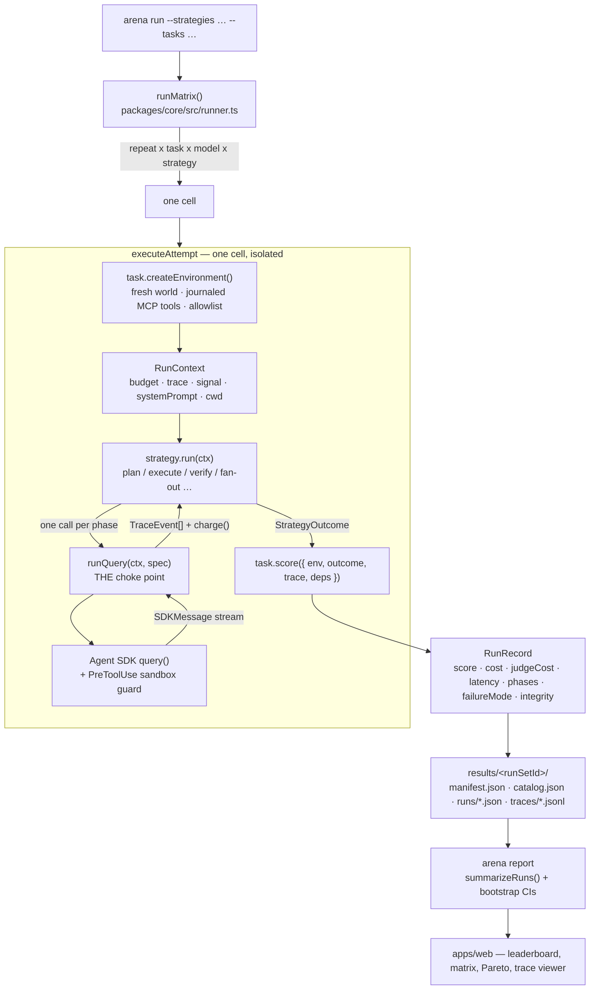

# Architecture

How a benchmark run flows, end to end, and why the seams are where they are.

The whole design follows from one requirement: **the only thing allowed to differ between two
rows of the leaderboard is the architecture under test.** Everything below is either a mechanism
for holding something else constant, or a mechanism for proving afterwards that it was.

---

## The flow



---

## 1. `runMatrix` — the sweep

[`packages/core/src/runner.ts`](../packages/core/src/runner.ts)

`runMatrix` expands `{models} x {strategies} x {tasks} x {repeats}` into a flat list of cells and
drains it with a fixed pool of workers (`concurrency`). The order is repeat → task → model →
strategy, so a session that stops early has run every model and architecture on the same tasks
rather than some of them on all tasks. Cells are independent by construction — each builds its own
world — and records are sorted by `runId` at the end, so a run set is byte-stable regardless of how
the pool happened to interleave.

What lives at this level rather than inside a cell:

- **The total budget.** A run starts only when its full per-run cap fits beside everything already
  spent and everything reserved by the runs in flight (`TotalBudget` in
  [`budget.ts`](../packages/core/src/budget.ts)). Gating on finished runs alone let every worker
  start a run just under the line. A run that does not fit waits for one in flight to settle; when
  none is in flight the session stops, and the manifest records `stoppedBy: 'total_budget'`.
  Grading is charged against the total when a run settles but has no cap of its own to reserve.
- **Retries.** A run that lost a model call or every grading call to a transient API failure (rate
  limit, overload, server error) is run again from scratch after an exponential, jittered back-off,
  three attempts by default (`retry`). The record keeps the attempt that counted, `attempts`, and
  what the discarded ones cost (`discardedCostUsd`), which never enters `costUsd`. A failure a
  retry cannot fix, or the last attempt's, is recorded as `api_error`. Rejected credentials stop the
  session: every further run would fail the same way.
- **Stopping.** `signal` is a hard stop: nothing new starts, the runs in flight are aborted and
  discarded, since a run cut off from outside is not a measurement. `drainSignal` is a soft one:
  nothing new starts and the runs in flight finish and are recorded.
- **The manifest.** Written when the session starts and again after every run, with `status`
  `running`, then `interrupted` (and `stoppedBy`) or `complete`. It records the settings that
  decide what was measured (models, strategies, tasks, repeats, effort, fixture mode, per-run caps,
  judge model, effort and samples), the operational ones (concurrency, total budget, retry policy),
  the totals, and provenance: git sha and whether the tree was dirty, Agent SDK and bundled Claude
  Code versions, Node version, platform and command line
  ([`provenance.ts`](../packages/core/src/provenance.ts)). This is what makes a result citable.
  Beside the effort that was asked for, `effectiveEffort` gives the level each model actually ran
  at, from its records: `null` for a model that was sent no effort parameter at all, such as
  Haiku 4.5, so a manifest cannot claim compute a model never used.
- **Resuming.** `skipCells` leaves out cells an earlier session finished; `completedCells(runSetId)`
  lists them from `runs/*.json`, except `api_error` records, which measured nothing and run again.
  A run set that already holds runs is only written to this way, and only under the settings it was
  measured with; the manifest keeps each earlier session in `previousSessions`.

A cell whose bookkeeping throws does not take the sweep down. It is reported as `run-error` and
the pool moves on. Run-set ids that could climb out of `results/` (`../`, separators, absolute
paths) are refused before anything is written.

## 2. Per-cell environment

`task.createEnvironment({ cwd, fixtureMode, fixtureDir })` returns a `TaskEnvironment`:

```ts
interface TaskEnvironment {
  createMcpServers(filter?: { only?: readonly string[] }): Record<string, McpServerConfig>;
  allowedTools: string[];    // mcp__<server>__<tool>, the exact permitted set
  readOnlyTools: string[];   // subset that cannot mutate state
  state: unknown;            // the world the scorer will inspect
  journal: ToolCall[];       // every invocation, appended by the wrapper
  dispose?(): Promise<void> | void;
}
```

Every task builds its tools through `createJournaledToolServer`
([`tools.ts`](../packages/core/src/tools.ts)), which wraps each handler so that **every**
invocation lands in `journal` with its arguments, result, success flag and relative timestamp.
The journal is the scorer's ground truth for "what did the agent actually do", entirely
independent of anything the agent claims in prose. Handler exceptions are converted into error
replies rather than propagating, because a thrown tool would abort the run and make the strategy
look worse than it was.

`createMcpServers` is a factory, called by `runQuery` once per model call. An in-process MCP
server accepts one session at a time, so a single instance shared by every phase left parallel
phases after the first with no tools at all (the first published run set lost two of three
`debate-select` proposers that way; the architecture is now `propose-select`). Each call now gets new server instances whose handlers close
over the same world and journal, so state is still shared. The `only` filter limits a call to the
tools it may use: a tool-less phase gets no task server, a read-only phase only the read-only tools.

`readOnlyTools` exists because two architectures need it: `propose-select` hands only read-only
tools to its three parallel proposers, and `plan-execute-verify` hands only read-only tools to its
verifier so it has to check the real state rather than the executor's account of it. When
`readOnlyTools.length === allowedTools.length` the task has nothing to mutate, which is how
`propose-select` knows to skip its execution phase on research tasks instead of burning a call.

Each attempt also gets its own scratch `cwd`, made with `mkdtemp` under the OS temp directory and
removed in a `finally` block whatever happens, so concurrent runs never share one and nothing is
written into the repository.

## 3. Strategies

[`packages/strategies/src/`](../packages/strategies/src/)

A strategy is orchestration and nothing else:

```ts
interface Strategy {
  id: string;
  label: string;
  description: string;
  run(ctx: RunContext): Promise<StrategyOutcome>;
  fidelityChecks?(input: FidelityInput): IntegrityCheck[];  // see section 8
}
```

Strategies never import the Agent SDK. They call `runQuery`, taken as an injectable dependency
(`StrategyDeps`), which is what lets the orchestration logic — how many calls, in what order, with
which tools, what happens when a phase returns nothing — be tested without a network or an API
key. Two suites do it. `strategies.test.ts` injects a fake `runQuery` and pins the orchestration
itself, every fallback included. `realSeam.test.ts` drives every architecture through the real
`runQuery`, sandbox guard and per-call MCP servers against a scripted SDK — the layer a fake
`runQuery` hides, and where the first published run set broke — and computes the integrity checks
on what came out: each architecture's ordinary run must pass them all, a degraded run of each must
fail them, and `gated-execute` must let allowed actions through and keep denied ones out of the
world.

`createPhaseRunner` ([`helpers.ts`](../packages/strategies/src/helpers.ts)) carries the
bookkeeping every architecture shares:

- **One `PhaseRecord` per model call**, listed in the order the calls *started*, never the order
  they finished, so a fan-out's phase list is stable and a review made while an executor waits on
  it is listed after the executor. `startedAtMs` comes from the call itself, so parallel phases
  share one timeline.
- **`annotate`**, which adds what the strategy read from a phase's reply to its record: `meta`
  (a plan's step count, a verdict, a winner, a reviewer's decision), `degraded`, `retriedBy`.
- **A fallback answer** for when the phase meant to give the answer comes back empty: the text
  of the latest-started *answer-bearing* phase (`main`, `execute`, `worker-*`, `revise-*`,
  `synthesize`). A planner's, verifier's, selector's or reviewer's text is never an answer, so it
  can never stand in for one.
- **`runAll`** for fan-out, which gives each sibling an equal share of the budget available when
  the batch starts, so none can be starved by another.
- **`canContinue()`**, the budget and abort check every strategy makes before another phase.
- **A halt on the first API failure.** A run that lost a call to the API is recorded as
  `api_error`, ranked nowhere and run again, so the phase runner stops it there: `canContinue()`
  turns false and the calls still in flight are aborted, rather than paying for a selection or an
  execution nobody will use and making more calls to an API that is turning them away.

### Prompt parity

Shared helpers keep the phases symmetric, so that a difference between two architectures is a
difference in architecture and not in wording:

- `taskBlock(ctx)` quotes `ctx.task.prompt` verbatim into every phase of every architecture.
- Every *acting* phase — one holding the tools that change state: `single`'s `main`, every
  `execute`, every `worker-*`, every `revise-*` — gets `ACTING_INSTRUCTIONS` word for word: check
  the state you are about to change before you change it, and when anything you were given or
  found conflicts with the task or the domain rules, follow the task and the rules and say so.
  Before this, only two executors were told to put the task and the rules first, and only
  `single` was told to check state before changing it.
- Every acting phase whose reply is the answer ends with the same `FINAL_ANSWER_INSTRUCTION`. The
  one intended difference: a worker is asked for a report, because its reply goes to the
  orchestrator, not to the user.
- What else an acting prompt says is the architecture's own context — the plan it was handed, the
  issues it must fix, the assignment it was given, that a reviewer gates its actions — and nothing
  more. `strategies.test.ts` asserts all of this for every architecture.

### Turn budgets

`maxTurns` is set per call, by one policy for every architecture:

| Phase kind | `maxTurns` | Phases |
| --- | --- | --- |
| holds tools, acting or read-only | the task's own `maxTurns` (T) | `main`, `execute`, `worker-*`, `revise-*`, `verify-*`, `propose-*`, `review-*` |
| no tools, answers through a schema | `SCHEMA_MIN_TURNS` = 3 | `plan`, `decompose`, `select` |
| no tools, answers in prose | `REASONING_TURNS` = 1 | `synthesize` |

T is the allowance the task's author sized for one agent doing the whole task, so every phase that
works with tools gets what a single agent would. A schema phase gets three turns because the
structured reply is itself a tool call and one that fails validation needs a turn to retry; a call
stops at its first valid reply, so the room costs nothing when it is not needed. A schema phase
that holds tools (`verify-*`, `review-*`) gets T or three, whichever is more.

The total is therefore **not** equal across architectures, and that is a decision, not an
oversight:

| Strategy | Most tool-holding turns in one run |
| --- | --- |
| `single` | T |
| `plan-execute` | T |
| `orchestrator-workers` | N·T, for N ≤ 4 workers |
| `plan-execute-verify` | 5T: execute, two verify rounds, two revisions (each verify round can be asked once more, up to 7T) |
| `propose-select` | 4T: three proposers and the executor |
| `gated-execute` | T + R·T, for R reviews (one per state-changing call) |

A run-wide turn ledger would make an architecture's phases compete for turns in an order that
depends on how early phases happened to go, and a reviewer or verifier starved of turns would fail
for reasons that have nothing to do with its design. What *is* shared is the run's cost and
wall-clock ceiling: every call of every architecture draws on the same per-run budget, and it is
cost, not turns, that the comparison holds fixed. Turns spent are recorded on every run
(`RunRecord.turns`, and per phase), so a reader can see where an architecture's extra allowance
went.

Two architectures split the shared budget between calls that run at the same time. `runAll` gives
parallel siblings equal shares. `gated-execute`'s executor reserves half of the budget available
when it starts (`EXECUTOR_BUDGET_SHARE`) and leaves the rest to its reviews, which run while it
waits; each review reserves at most half of what is then available.

### The architectures

Phase names as they appear in traces and reports:

| Strategy | Phases |
| --- | --- |
| `single` | `main` |
| `plan-execute` | `plan` → `execute` |
| `orchestrator-workers` | `decompose` → `worker-<id>` x N (parallel, depth 1) → `synthesize` |
| `plan-execute-verify` | `plan` → `execute` → `verify-1` → `revise-1` → `verify-2` → `revise-2`, stopping at the first verdict that does not call for a revision; `verify-<n>-retry` when a verdict had to be asked for again |
| `propose-select` | `propose-1..3` (parallel, depth 1, one lens each) → `select` → `execute` (no `execute` on a task with nothing to mutate) |
| `gated-execute` | `execute`, with a `review-<n>` (depth 1) for each state-changing call, made while the executor waits |

`propose-select` was published as `debate-select`; its proposers never see one another, so there
was never a debate. `LEGACY_STRATEGY_IDS` maps the old id, which old run sets keep, to the new one.

## 4. `runQuery` — the choke point

[`packages/core/src/runQuery.ts`](../packages/core/src/runQuery.ts)

Every model call in the system goes through this one function. That is the central design decision
of the project, and it is what makes the comparison mean anything: if each architecture set up its
own `query()` call, a leaderboard difference could just as easily be a difference in instrumentation
— one strategy inheriting a setting, another accounting for cost differently, a third silently
allowed a tool the others were not.

Held identical for every architecture, on every call:

| Concern | Mechanism |
| --- | --- |
| Tool access | the call's own MCP servers, showing only `allowedTools` from the task (or an explicit narrower list); `tools` pinned so no built-in tool is offered; `disallowedTools: SANDBOX_DENYLIST`, `permissionMode: 'dontAsk'` |
| Hermeticity | `settingSources: []`, `strictMcpConfig: true` and `settings: { disableClaudeAiConnectors: true }` — no `~/.claude`, no repo settings, no `.mcp.json`, no claude.ai connectors |
| Cost ceiling | a lease from `ctx.budget.reserve()` is the call's `maxBudgetUsd`, so concurrent calls can never together hold more than the run has left |
| Cost accounting | the call's own `result` message settles its lease; a call that never gets one (aborted, crashed) is charged for the usage it streamed, priced from a list-price table and flagged `costEstimated` |
| API failures | auth, rate-limit, overload, server and invalid-request failures come back as `apiError` and never as answer text. The CLI's notice that the model could not finish — it ran out of output tokens or context, could not form a tool call the CLI could parse, or its safeguards refused — is dressed the same way but is the run's own outcome: it comes back as `modelStop`, never as `apiError`, so it counts against the run instead of being retried and excused, and never as answer text either |
| Trace capture | every SDK message is normalized and appended to `ctx.trace`, tagged with the call's `callId` |
| Effort | `ctx.effort` is requested on every call; the level the CLI actually applied, which it lowers or drops for a model that does not support it, is read from the `PreToolUse` and `Stop` hooks and recorded as `effectiveEffort` on the call, the run record and the manifest |
| Abort | the parent `AbortSignal` is forwarded, and the stream is cut mid-flight the moment `budget.exceeded` flips |
| Isolation | `persistSession: false`, per-run `cwd` |
| Structured output | `outputSchema` → `outputFormat: { type: 'json_schema' }` with the SDK's `StructuredOutput` tool allowed, read back by `readStructured`; a schema phase that gets none back is flagged `structuredMissing` |

`runQuery` never throws for an out-of-budget or aborted run. It returns an empty `QueryOutcome`
with `aborted: true` and a reason, so a strategy that runs out of money mid-plan degrades into a
recorded partial result rather than a harness error.

`readStructured` falls back to parsing JSON out of prose when the model answers without honouring
the schema — a formatting slip should not discard a phase that produced usable content.

## 5. The sandbox guard

[`packages/core/src/guard.ts`](../packages/core/src/guard.ts)

`SANDBOX_DENYLIST` blocks the built-in tools — `Bash`, `Read`, `Write`, `Edit`, `Glob`, `Grep`,
`WebFetch`, `WebSearch` and the rest. `runQuery` already offers no built-in tools at all, so the
denylist is the second line of defence.

On top of the denylist and the allowlist there is a `PreToolUse` hook that checks each tool name
against the allowlist (supporting `mcp__server__*` wildcards, and including `StructuredOutput`
whenever the call asked for a schema) and denies anything outside it. That
is redundant as an access control — `permissionMode: 'dontAsk'` with an exact allowlist already
blocks it. It is not redundant as *evidence*: the hook writes a `tool_denied` trace event and
increments a counter that ends up on the run record as `deniedToolCalls`. Without it, "this
architecture never tried to leave the sandbox" and "this architecture tried repeatedly and was
stopped" would look identical in the data, and they are a real behavioural difference.

The same hook is also the seam for reviewing actions before they run. A call whose spec carries
`reviewToolCall` has every tool call the allowlist permits (harness tools aside) held until the
reviewer decides; a denial goes back to the model as that tool's result, with the reviewer's
reason. `gated-execute` is built on it. A reviewer's denial is the architecture's decision, not a
sandbox violation, so it is neither traced as `tool_denied` nor counted in `deniedToolCalls`. A
review that throws becomes a denial, because the CLI lets a call through when its hook throws, and
the hook's matcher gets a long timeout so that a review is bounded by the run's wall-clock cap
rather than by the CLI's hook timeout.

## 6. Budget and trace

**`BudgetTracker`** ([`budget.ts`](../packages/core/src/budget.ts)) is the run-level ledger. The SDK
enforces `maxBudgetUsd` per `query()` call, but an architecture making six calls, some at once,
needs a ceiling above them all. Each call reserves a lease out of what is neither spent nor
reserved, hands it to the SDK as its `maxBudgetUsd`, and settles it with its actual cost. The cap
is soft by at most one turn per call in flight, because the SDK checks its budget between turns.
The wall-clock limit is evaluated lazily inside `stopReason`, so a stalled run trips even though
nothing has been charged.

**`TraceCollector`** ([`trace.ts`](../packages/core/src/trace.ts)) holds a normalized
`TraceEvent[]`. The normalizer is deliberately decoupled from the SDK's `SDKMessage` union — that
union has dozens of members and grows between releases, and anything unrecognized is skipped
rather than thrown. Stored traces therefore stay readable across SDK upgrades, and so does the
viewer. Events carry `phase`, `callId`, `depth` (0 for the main thread, 1 for a subagent), `seq`
and `tMs`, which is what lets the UI lay parallel phases out on one timeline. `callId` is what ties
an event to its call when concurrent calls interleave: usage and salvaged text are never read back
from the shared trace, only from each call's own stream.

## 7. Scoring

Two scorers, deliberately different in kind.

**Tool-use** ([`defineToolUseTask.ts`](../packages/tasks/src/defineToolUseTask.ts)) reads the final
world and the journal, and computes

```
raw   = Σ(weight_i x earned_i) / Σ(weight_i)
score = clamp01(raw x Π multiplier_j)
```

Penalties multiply so a hard rule (`multiplier: 0`) cannot be bought off with credit elsewhere. A
throwing assertion scores zero and the rest still report, so one bad predicate cannot discard an
otherwise valid data point. No model is involved anywhere in this path.

**Research** ([`defineResearchTask.ts`](../packages/tasks/src/research/defineResearchTask.ts)) has
a model-graded half and a deterministic half. The rubric half calls `sampleJudge` for N independent
gradings and reduces each item by median. The citation half calls `auditCitations`, comparing URLs
extracted from the answer against the URLs actually opened — collected from both the trace and the
journal, because a retrieval made inside a subagent may never surface in the parent trace. Judge
spend is routed through a wrapper in the runner so it accrues to `judgeCostUsd` and never to the
strategy's `costUsd`; a grading call that fails is still billed. The wrapper also runs the judge on
the run's own `subprocessEnv`, so a live-demo run is graded on the visitor's key. The judge itself
([`judge.ts`](../packages/core/src/judge.ts)) is hermetic like every agent call, offers no tools
beyond the structured-output one, runs at a pinned effort (its own default, or the one the task's
request names) and gives up after a timeout. A run whose every grading call failed is labelled
`api_error` (or `harness_error` when the judge answered but never usably) rather than
`wrong_answer`.

## 8. Integrity and failure modes

[`packages/core/src/integrity.ts`](../packages/core/src/integrity.ts)

The first published run set scored five architectures although four of them never ran as
designed, and every sign of it was in the traces. So every record now carries
`integrity: { ok, checks[] }`, and a run with `ok: false` must not be ranked.

The runner's own checks (`harness.*`) read the trace call by call: no call failed at the API or
ended without a result; the guard never denied `StructuredOutput` or any tool the session itself
offered; every MCP server a call was given reported `connected`, and no other server loaded; no
call was offered one of Claude Code's own tools, only its task's and the structured-output tool; every
schema call that ran to the end got its structured output; no phase was marked `degraded` by its
strategy; and, for graded runs, at least one grading call returned a usable verdict. A schema
call whose strategy asked for its reply again (`PhaseRecord.retriedBy`) is judged by the retry,
which is checked like any other schema call.

Every strategy adds its own invariants through `fidelityChecks`, read from the phase records the
strategy annotated and from the tools each session listed when it started:

| Strategy | Checks |
| --- | --- |
| `single` | `single.tools`: the agent held the whole toolset |
| `plan-execute` | `.plan`: the plan was read from the schema reply, with at least one step · `.tools`: no tools for the planner, all of them for the executor |
| `orchestrator-workers` | `.decomposition`: the subtasks were read from the schema reply · `.fan-out`: every planned worker ran (one when the orchestrator chose not to split), none starved while the others ran · `.synthesis`: the synthesis wrote the answer · `.tools` |
| `plan-execute-verify` | `.plan` · `.verdicts`: every review round's verdict was read from the schema reply, after at most one re-ask · `.loop`: every verdict calling for a revision got one, and no revision ran without one · `.tools`: read-only tools for the verifier |
| `propose-select` | `.proposals`: all three proposers ran, one per lens, none starved · `.selection`: the selector chose a valid proposal number through the schema · `.tools`: read-only tools for the proposers, none for the selector |
| `gated-execute` | `.reviewed`: every state change in the journal had been allowed by a review · `.decisions`: every review gave its decision through the schema · `.tools`: read-only tools for the reviewers |

Whenever a strategy carries on with a substitute instead of what a phase was meant to produce — a
plan written in prose or not at all, a decomposition it could not read, a default winner, a
verdict it could not read even when asked again, a selector or synthesis that wrote no answer, a
review with no readable decision — it records that on the phase as `degraded`, and both
`harness.not-degraded` and the strategy's own check fail. Nothing defaults silently: an unreadable
verdict is never approval, and an action no reviewer could decide on is denied.

Running out of budget or time is not an integrity failure, and neither is an acting phase running
out of turns. Such a run is a valid, losing data point; excluding it would flatter exactly the
architectures that fail that way. A phase the run's limits cut short is therefore never marked
degraded, and a fidelity check about a phase that was cut short, or never started because the run
had stopped, passes. (A run stopped by an API failure passes them too, but fails `harness.api` and
is never ranked.) A planner, decomposer, selector, verifier or reviewer that uses up its turns
without giving its structured reply is different: it ran to the end of what it was given and the
architecture still did not get the plan, split, choice or verdict it is built on, so that run
fails `harness.structured-output` and the strategy's own check.

`failureMode` names why a run did not pass, and every member is one the pipeline produces:

| Mode | Set by | When |
| --- | --- | --- |
| `wrong_answer` | `buildScore` | the state or answer fell short, and nothing more specific explains it |
| `policy_violation` | `buildScore` | a hard rule penalty, or a rule penalty that alone cost the pass |
| `hallucinated_citation` | `buildScore` | every rubric item held, but citing unopened pages cost the pass |
| `max_turns` | runner | a phase holding tools that act on the task ran out of turns |
| `budget_exceeded` | runner | the run hit its cost cap |
| `timeout` | runner | the run hit its wall-clock cap |
| `harness_error` | runner | the environment, strategy or grader threw, the judge never answered usably, or a call that crashed, lost its tool server or had a harness tool denied explains a run that did not pass |
| `api_error` | runner | a model or every grading call failed at the API; never graded, never ranked |

## 9. The fixture layer

[`webTools.ts`](../packages/tasks/src/research/webTools.ts) ·
[`fixtureStore.ts`](../packages/tasks/src/research/fixtureStore.ts)

Research agents get exactly two tools, `search` and `fetch_page`, and the built-in `WebSearch`/
`WebFetch` are denied. Routing every retrieval through our own tools buys three things at once:
replay determinism, a per-task domain allowlist, and — most importantly — a provable record of
which pages were opened, which is what makes the citation audit possible at all.

`FixtureStore` is a content-addressed cache, one JSON file per key. The key hashes the
whitespace-and-case-normalized request, so `RFC  7538` and `rfc 7538` share a recording instead of
missing and silently penalising the strategy.

| Mode | Behaviour |
| --- | --- |
| `replay` | Fixtures only. A miss returns an explanatory error telling the agent it is offline, so it continues with what it has instead of hallucinating. CI and the weekly benchmark default. |
| `record` | Real requests, written to the store. Run once, commit, replay forever. |
| `live` | Real requests, nothing persisted. For probing whether a page has changed. |

Fixtures store more text than the model is shown (60k vs 6k chars), so raising the render cap does
not require re-recording.

## 10. Statistics

[`stats.ts`](../packages/core/src/stats.ts) · [`aggregate.ts`](../packages/core/src/aggregate.ts)

`summarizeRuns` reduces raw records into everything the site renders, once, at report time — the
site stays a pure renderer with no statistics of its own.

- **Bootstrap CIs.** Percentile bootstrap for the mean, 2,000 iterations, from a seeded mulberry32
  PRNG. The seed matters: confidence intervals that moved between two reports of the same data
  would not be citable.
- **`comparisonVerdict`.** Returns `inconclusive` whenever two intervals overlap, and only names a
  winner when they do not. Overlap-based rather than a formal test — it is conservative, which is
  the right direction to err with a handful of repeats.
- **`paretoFrontier`.** Strategies not dominated on both score and cost. The interesting question
  is rarely "which is best" but "which is worth what it costs", and `scorePerDollar` is computed
  alongside for the same reason.
- **Per-category summaries.** `tool-use` and `research` are summarized separately as well as
  together, because an architecture that helps on procedural sandbox work and one that helps on
  open-ended research are not the same claim.

## 11. Persistence and the site

```
results/
  latest.json                 { "runSetId": "…" } — what the site renders by default
  <runSetId>/
    manifest.json             status, settings, provenance, totals, sessions
    catalog.json              strategy and task metadata as of that run
    runs/<runId>.json         one RunRecord per strategy x task x repeat
    traces/<runId>.jsonl      one normalized TraceEvent per line
    REPORT.md                 written by `arena report --markdown`
```

`catalog.json` is written per run set rather than read from the live code, so a historical result
still renders with the task prompts and strategy descriptions *as they were when it was measured*.

`runId` is `<model>__<strategyId>__<taskId>__r<repeat>` (run sets from before models were a matrix
dimension omit the model) and `runSetId` is an ISO timestamp with a random suffix, so both sort
meaningfully and neither collides. Every JSON file is written to a temporary name and renamed into
place, so a reader never sees half a manifest. Run records are committed; traces are gitignored by
default because they are large. `latest.json` is tracked, so the runner moves it only when asked
(`updateLatestPointer`).

The manifest's optional `synthetic: true` flag is set by exactly one thing —
`scripts/generate-demo-data.ts` — and the site renders an unmissable banner when it sees it.
Fabricated data exists so the interface can be built without spending money, and it must never be
mistakable for a measurement.
